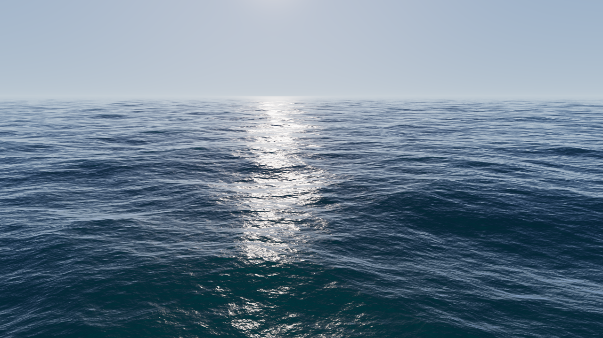

# WebGPU Ocean

**A real-time Tessendorf FFT ocean in the browser, built with Three.js `WebGPURenderer` and TSL compute shaders. Three wave cascades, Jacobian whitecaps and physically-inspired water shading.**



<!-- GIF -->

**Live demo:** https://iodiot.github.io/webgpu-ocean/ (try `?preset=Storm`)

## Features

- **FFT ocean, all on the GPU.** Every frame, 3 cascades × 8 spectral fields (256² each) are evolved, inverse-FFT'd and assembled in compute shaders. Nothing is read back to the CPU.
- **Physically based wave spectrum.** JONSWAP (fetch-limited wind sea) or Phillips, deep-water dispersion ω = √(gk) and cos² directional spreading. Amplitudes are in metres, so wind speed in m/s gives plausible wave heights (Breeze: about 2 m significant wave height).
- **3 cascades** (250 m, 37 m and 7.3 m patches, non-integer ratios). Each cascade owns its own band of wavenumbers, so no wave is counted twice. Together they cover swell down to ~6 cm ripples without visible tiling.
- **GPU FFT written in TSL.** A radix-2 Stockham transform runs in workgroup shared memory: one workgroup per row or column, 8 stages unrolled at shader-build time. Pairs of real fields are packed into one complex IFFT (8 fields → 4 transforms).
- **Choppy waves.** Horizontal displacement `D = IFFT(i·k̂·h)` sharpens the crests.
- **Whitecaps.** Foam appears where the Jacobian of the displacement says the surface folds (J < threshold), and decays exponentially over time.
- **Shading.**
  - Per-pixel normals from analytic slopes, corrected by the horizontal stretch.
  - Schlick Fresnel reflection of an analytic sky.
  - GGX sun glint, with roughness that grows with distance.
  - Fake subsurface scattering on backlit crests.
  - Lit foam.
  - Exponential fog that blends seamlessly into the horizon.
  - ACES tone mapping.
- **Camera-centred polar LOD grid.** Ring radii grow exponentially, so ~190k vertices cover a 9 km radius at roughly constant projected density. Vertex texture LOD follows the local vertex spacing.
- **Controls (lil-gui).**
  - Sea-state presets: **Calm / Breeze / Storm**.
  - Waves: spectrum type, wind speed, wind direction, fetch, wave scale, choppiness, directional spread.
  - Foam: amount and decay.
  - Lighting: sun elevation and azimuth, overcast, exposure, fog.
  - Time: time scale, pause (`Space`).
- **Interaction and fallback.** Orbit camera, FPS/frame-time overlay, and a graceful fallback screen when WebGPU is unavailable. three.js would silently fall back to WebGL 2, but the FFT needs compute shaders with workgroup memory, so the demo checks for WebGPU explicitly.

## Architecture

```
src/
  main.ts              bootstrap, WebGPU check, scene, frame loop
  sim/
    params.ts          tunables, cascade sizes/bands, Calm/Breeze/Storm presets
    noise.ts           seeded Gaussian noise for the initial spectrum
    OceanSim.ts        TSL compute kernels: spectrum init, time evolution, assemble/foam
    fft.ts             TSL Stockham FFT in workgroup memory
  render/
    oceanMaterial.ts   TSL vertex displacement + water shading (MeshBasicNodeMaterial)
    sky.ts             analytic sky shared by the dome, reflections and fog
    grid.ts            camera-centred polar LOD mesh
    uniforms.ts        sun / fog / grid uniforms
  ui/
    gui.ts             lil-gui panel + presets
    stats.ts           FPS overlay
```

### Per-frame GPU work (one compute pass, 12 dispatches)

For each cascade:

1. **Evolve.** `h(k,t) = h0(k)·e^(−iωt) + conj(h0(−k))·e^(iωt)`. From it, build the spectra of the height, `Dx`, `Dz`, `∂h/∂x`, `∂h/∂z`, `∂Dx/∂x`, `∂Dz/∂z` and `∂Dx/∂z`, packed pairwise as `A + iB` into two `vec4` grids.
2. **Row IFFT, then column IFFT.** One workgroup of 128 threads per line. Each `vec4` holds two complex numbers, so each pass transforms 2 signals.
3. **Assemble.**
   - Undo the `(−1)^(x+y)` centring shift and apply choppiness λ.
   - Compute the Jacobian `J = (1+λDxx)(1+λDzz) − (λDxz)²`.
   - Update foam: `foam = max(foam·e^(−decay·dt), saturate((threshold − J)/0.4))`.
   - Write two `rgba16float` storage textures: displacement + foam, and slopes + Jacobian terms. three.js regenerates their mip chains, so the fragment shader gets trilinear + anisotropic filtering.

The initial spectrum `h0(k) = (ξr + iξi)·√(S(k)Δk²)/2` is baked on the GPU only when a spectrum parameter changes. Each texel computes both `h0(k)` and `h0(−k)`, so `h(k,t)` stays Hermitian and the IFFT output is exactly real.

### Rendering

- One `MeshBasicNodeMaterial` with custom `positionNode` and `colorNode` written in TSL. three.js compiles the nodes to WGSL.
- The vertex stage samples the three displacement textures at the undisplaced (Lagrangian) position.
- The fragment stage rebuilds the normal of the displaced surface as `n = normalize(−sx/(1+λDxx), 1, −sz/(1+λDzz))` and then shades.
- The sky dome, reflections and fog all use the same sky function, so the edge of the 9 km mesh disappears into the horizon.

## Verification

- `npm run build` (type check + Vite build) and `npm run lint` pass.
- **The GPU FFT is checked numerically.** With `?debug`, internals are exposed on `window.__ocean`. A headless Chrome run (SwiftShader WebGPU) read back `h0` and the post-IFFT buffers. A NumPy reference (evolve with the same formulas, `ifft2`) matched within ~5·10⁻⁴ absolute, which is fp32 rounding on values up to ~2 m. Hermitian symmetry was exact.
- The screenshots above were captured from the running demo (Chrome + SwiftShader, read straight from the canvas).

## Performance notes

- The compute work is fixed-size: 3 × (65k-thread evolve + 2 × 512-workgroup FFT + 65k-thread assemble), independent of resolution.
- About 460k triangles are drawn for the ocean, plus a sky dome. MSAA is on.
- Possible next steps:
  - Merge the cascades into texture arrays to cut dispatches and bindings.
  - Use radix-4 / radix-8 FFT stages.
  - Quantise ω for a perfectly looping time.
  - Add a screen-space foam texture and spray particles.
- Measure on your hardware and put the numbers here, e.g. _"Breeze, 1080p: X FPS on <GPU>"_.

## Run locally

Requires Node 20+ and a WebGPU-capable browser (Chrome/Edge 113+, Safari 26+, Firefox 141+ on Windows).

```bash
npm install
npm run dev        # http://localhost:5173/webgpu-ocean/
npm run build      # type-check + production build to dist/
npm run preview    # serve the production build
npm run lint
```

URL parameters: `?preset=Calm|Breeze|Storm`, `?debug` (exposes `window.__ocean` for automated checks).

## Deployment

`vite.config.ts` sets `base: '/webgpu-ocean/'`. The site is served by GitHub Pages from the `gh-pages` branch, which holds the contents of `dist/` plus `.nojekyll`.

## References

- J. Tessendorf, *Simulating Ocean Water* (2001).
- Hasselmann et al., *JONSWAP* (1973).
- C. Horvath, *Empirical Directional Wave Spectra for Computer Graphics* (2015).

## License

[MIT](LICENSE) © Mike Smahin
